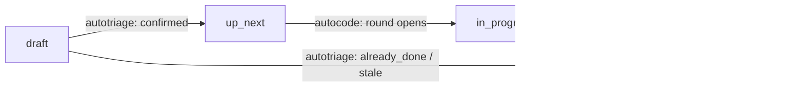

# Backlog System

Markdown kanban at `~/obsidian/backlog/`, read and written by the
[[tools|MCP tools server]], the Mission Control board, the guardian, and the
unattended triage/implement loop — plus the board steward, which proposes statuses
and writes them only with `apply: true`, and `workers/board_disagreement.py`,
which files the steward's disagreements (see **The tags the loop writes on
itself**). 4,047 task files on 2026-11-12 (the dashboard's own count): 4,037 on
the `lloyd` board, 7 `alfie` (robot firmware), 3 `personal`, with 50 of the whole
board open. Every other board name the 2026-09-13 census
recorded (`Architecture`, `backlog`, `default`) is gone — the writers refuse those
names now (see `app/backlog_boards.py` in **Frontmatter** below). The directory
also holds files that are not tasks — `verdict-log-2026-09.md`, and a `data/`
subdirectory of run witnesses and dry-run records, which no reader globs into
because none recurses — and every reader skips them, because what makes a file a
task is the numeric id prefix on its **name**, not anything inside it.

The file **is** the record. There is no database, no index that has to be kept
in sync, and no writer that holds state between calls — every reader globs the
directory and parses frontmatter. That is what makes the board survivable: a
task is diffable, greppable, restorable from a tarball, and editable by hand
in Obsidian while four programs are writing to it.

## Storage

- **Path:** `~/obsidian/backlog/{id}-{slug}.md`, flat — no board subdirectories.
- **Being flat is a read-side contract, not only a write-side convention.** The
  qmd `backlog` collection indexes that directory recursively, so the run
  witnesses and dry-run records under `backlog/data/` are embedded and
  searchable *beside* the tasks while no reader globs the directory that way —
  which means a reader that takes an item id from any component of a hit's path
  reads a date-stamped witness as an item, and a similarity score a witness
  earned against its own text ends up spent on that item's title and status.
  `app/backlog_paths.py` is the one definition of which hit stands for which
  item: an id is taken only from a path that is a direct child of the collection
  root, so a `backlog/data/` row carries no id, no score and no vector. Both
  readers that map a hit back to an item — `agent_mcp/backlog_similar.py` over
  the daemon's reply and `scripts/automod/cluster.py` over the index's own rows —
  go through it. The witness rows stay embedded; what changed is that nothing
  reads an item out of them.
- **Id:** parsed from the **filename** (`^(\d+)[-_].*\.md$`), not the
  frontmatter. A create takes `max(existing ids) + 1`. 188 legacy files still
  carry an `id:` key; no current writer emits one — `agent_mcp/backlog.py::save_task`
  explicitly drops `id`, `filename` and `body` before dumping the frontmatter.
- **Slug:** generated once from the name at creation (lowercased, every
  non-alphanumeric run collapsed to `-`, truncated to 50 chars) and never
  changes on rename.
- **Title:** the body's first `# ` heading. Also not frontmatter — a rename
  rewrites that heading in place and leaves the filename alone, which is why
  the slug and the title drift apart on old items.
- **Body:** markdown. The loop appends whole sections to it (`## Automod triage
  — <date>`, `## Automod landed — <date>`, `## Merged finding — <date>`,
  `## Findings (round …)`), so an item's body is its own history.
- **Search:** a qmd collection, `backlog` (below).

## Status: four words, one definition



`app/backlog_status.py` is the vocabulary, and it is a shared module rather
than five agreeing literals for a reason. Five lists name a task's status —
`scripts/automod/backlog.py` for the loop, `agent_mcp/backlog.py` for the
`backlog_*` tools, `app/routers/backlog.py` for the Mission Control writer,
`app/routers/dashboard.py` for the board's counters, and `STATUSES` in the
React `BacklogPage` — and they all agreed on the four words, so **drift
between them was never the bug**.

The bug was that none of them had a case for a value *outside* the four, and
the two halves then disagreed in the worst possible direction:
`dashboard._BACKLOG_CLOSED` counted such an item as open work, while
`OPEN_STATUSES` could not see it at all. Nothing could move it either —
`set_status` and `reconcile_statuses` both reach items through `open_items`,
which filters *on status*, so the pass that exists to correct a status is
structurally unable to reach the one status that is wrong in this particular
way. #287 (`review`) and #304 (`closed`) sat in that gap from April 2026 until
2026-09-09, stranded when the vocabulary was narrowed to four words and
nothing migrated what was already on disk.

- `PIPELINE_STATUSES` — `draft`, `up_next`, `in_progress`, `done`. Live counts
  (2026-11-12, `GET /api/dashboard` → `backlog.by_status`): 16 / 32 / 2 / 3,997.
  The 2026-10-13 reading was 6 / 0 / 6 / 2,580 and the 2026-09-13 census 456 / 68
  / 0 / 432; the board has since been settled and swept rather than emptied by
  hand; the corpus grew by 1,455 files over that month and the open count is 50
  against 12, of which `board_health` reads 28 as self-spawned — bounded by the
  sweep (3 unswept, 42 swept, 13 parked) rather than by expiry.
- `CLOSED_ALIASES` — `closed`, `cancelled`, `wontfix`. Exactly the non-`done`
  members of the set `dashboard._BACKLOG_CLOSED` has carried all along, which
  is the tree's only record that those words ever meant anything. Inventing
  more would be guessing at which of them are terminal.
- `canonical_status(value)` maps anything onto one of the four; case- and
  whitespace-insensitive, because `Done` is a human writing the same word
  rather than a new one. Empty or missing is `draft`.
- `is_off_vocabulary(value)` is deliberately **case-sensitive**, unlike
  `canonical_status`: `status: Done` strands exactly as `status: review` does,
  since no reader lowercases. An *absent* status is not off-vocabulary at all —
  every reader already defaults it to `draft`, so the two halves agree and
  there is nothing on disk to correct.

`backlog.rescue_off_vocabulary` walks by **board** rather than by status (it
uses `all_items`, the one reader that ignores `OPEN_STATUSES`; an Alfie item
with an unusual status is not this loop's to rewrite) and runs at the
top of every reconcile, before the main pass, so a rescued item is judged in
that same pass. The mapping is deliberately lopsided: only the legacy words
already known to be terminal reach `done`, and everything else becomes
`draft`. Calling a word terminal when it is not buries a live item where
nothing will look again; calling it live when it is not costs one triage run
that closes it. Pinned by `tests/test_backlog_status_vocabulary.py`.

## The pipeline writes the status; the ledger decides it

Until 2026-09-09 `status` was written in exactly two places, both `done`. A
`confirmed` verdict left an item wherever it was, no round ever set
`in_progress`, and #353 landed while still `draft`.

Now `autotriage` reads **`draft`** only and `autocode` reads **`up_next`**
only. Every other transition is derived rather than scattered:
`backlog.desired_statuses` computes what each open item's status *should* be
from the automod ledger, and `reconcile_statuses` writes the differences — on
every implement poll and after every turn. One table, so the migration of the
existing board and the steady state are the same code. Two rules keep it from
fighting a human: `done` is terminal for this writer, and the loop rewrites
only a status it has a ledger opinion about. The one exception is an untriaged
item parked in `up_next`, where nothing can pull it from — that goes back to
`draft`, where triage looks.

### A promotion is a request the ledger answers

That exception was a loop for anyone who wrote `up_next` by hand. Autonomy task
35 (the vault skill `backlog-triage`) promoted two to four drafts a night with a
status write and no ledger row; the reconciler moved each back within minutes;
and its line — "never triaged; autotriage reads draft" — read to the next
night's run as "still actionable". Measured 2026-10-04 over seven days: 77 of
168 `status_moved` rows were the reconciler undoing a promotion (53 never
triaged, 24 "not for the unattended loop"). #2030 went round four nights
running while quarantine kept triage from ever reading it.

`backlog_write_task(status="up_next")` is now ruled on at the write, from the
same table (`backlog.promotion_ruling`, applied by `apply_promotion_ruling`).
The answer comes back in the tool result as `promotion` and `message`, with the
`status` the item actually has, and the rest of the write (priority, activity,
description) is kept:

| The item | What the write does | `promotion` |
|---|---|---|
| The ledger would keep it in `up_next` (a confirmed, loopable, unheld contract; a re-offer) | the status moves | — |
| Never triaged, held as self-filed | stays `draft`; a `backlog_triage_requested` ledger row releases it to single triage (`released_ids`) | `request` |
| Never triaged, already a triage candidate | stays `draft`; nothing to do | `pooled` |
| Triaged out of the loop (`not_code`, `unverifiable`, human-only), nothing owed — and only a row whose `verdict_source` shows a model rendered it: `triaged_ids` skips a `none` row, which is a missing measurement and not a ruling (#2394) | stays `draft`; a `decide` entry is added, so owed-check owns it | `owe` |
| The ledger puts it elsewhere and something is already owed, held, in flight or spent | stays where it is, with the reconciler's reason | `ledger` |
| Folded under an umbrella | stays; its fate is the umbrella's | `grouped` |
| A create at `up_next` on a board the loop reads | filed as `draft`; nothing is released | `created_draft` |
| A board the loop does not read, or an item that is not open | written as asked | — |

The release is a new way out of quarantine, so it is bounded where quarantine's
own reason lives: an unattended caller (any non-chat session) gets
`TRIAGE_REQUEST_CAP` = 5 releases per rolling 24 h, counted from the ledger
across all such sessions; past it the answer is `capped` and the item clusters
or expires as before. A chat session is not capped. A failure anywhere in the
ruling is the old write (fail-open), and Mission Control's drag-to-column route
(`app/routers/backlog.py`) is unchanged — the reconciler still corrects it.

owed-check's `reopen` had the same hole from the other side: on an item with no
implement attempt it fell back to a bare `up_next` and settled the entry, so
#2041 (triaged `not_code`) was demoted two minutes later with nothing owed and
no owner. `owed._reopen_refusal` now asks the same ruling first: a reopen the
ledger cannot grant leaves the entry owed, counted as a recheck and carrying a
`note` the next pass is shown ("last answer not applied: …"), and after
`MAX_RECHECKS` it is ruled closed rather than asked again.

`architecture/automod.md` §3.2a–3.2c is the long version: the outcome
classes, what re-offers an item, and what closes it. What belongs here is the
part that is true of the board itself — an item's status is a claim about
where it is in that pipeline, and any other word is a bug rather than a
dialect.

## Frontmatter

Written by four programs and by hand, so every reader is defensive. What is
actually on disk:

| Field | Type | Notes |
|---|---|---|
| `status` | enum | `draft` \| `up_next` \| `in_progress` \| `done`. See above. |
| `board` | string | The board's **name** is its identity, and the set of names is closed since 2026-09-27: `app/backlog_boards.py::BOARDS` = `lloyd`, `personal`, `alfie`, checked by `check_board` in every writer (`agent_mcp/backlog.py`, both create and update in `app/routers/backlog.py`, `scripts/automod/backlog.py::new_item`), which raises `UnknownBoard` rather than folding a near-miss like `Lloyd`. `DEFAULT_BOARD` is `lloyd` — where a create naming no board (the guardian's alerts) lands. Before the list existed a board was whatever string a writer typed, and 19 items across 8 boards nobody had set up accumulated, 10 of them guardian alerts. **Reads never check the list**, so a hand-edited board still renders, and `board_ids` gives it an id above the configured block rather than letting it renumber a configured `board_id` (#2659). |
| `priority` | enum | `low` \| `medium` \| `high`. Both writers default `low` since 2026-09-16, and the loop's every pool sorts on it ahead of the sweep's rank (`scripts/automod/backlog.py::priority_key`); `none`, absent or unknown reads as `low`; `high` means "next": triage takes it before anything else and never holds it, the next round takes it first, and within `high` the newest wins. `round priority-backfill` writes `low` onto files that have none. Before that day MCP stamped `medium` and the HTTP route `none`, and nothing read either. |
| `tags` | list | Coerced through `app/backlog_tags.py::normalize_tags` — see below. |
| `blocked` / `assigned` | bool | Free-text filters on `backlog_tasks`; no machine acts on them. |
| `created` / `updated` | ISO datetime | `updated` is stamped by every writer. Naive **UTC** from `LOCAL_STAMP_CUTOVER` (2026-09-26T04:00), from `app/backlog_move.py::now_stamp` — below it, naive *local*: see "One clock, and where the old one stopped". |
| `completed` | ISO datetime | Written when a writer sets `done`. Always naive UTC — only the shared recorder and the automod closers ever wrote it, on both sides of the cut-off. |
| `position` | int | `id * 1000` at creation; the board's manual ordering. |
| `type` / `segment` | string | Both `backlog`. OKF conformance — see below. |
| `activity_log` | list | The audit trail. See "The activity log". |
| `parent` | int | The item this one was split from or found while implementing. Persisted from the prose first line by the clustering pass. 443 items (430 on 2026-10-13, 317 on 2026-09-13). |
| `group` | int | The umbrella a member was folded into (tag `grouped`). 40 items on 2026-11-12 (38 on 2026-10-13, 140 on 2026-09-13: umbrella-folding went off for the sweep on 2026-09-15 and back on the next day, and folded members were unfolded). |
| `members` | list[int] | The items an umbrella consolidates (tag `umbrella`). 16 items on 2026-11-12, down from 75 on 2026-10-13 (53 on 2026-09-13) — the umbrella count is 0 open on the board today, so consolidation is a key on closed history rather than live grouping. |
| `duplicate_of` | int | Written by a group triage's `duplicate_of` verdict. |
| `acceptance_clauses` | list | The contract the review rung holds a round to, on the item and not only in the ledger — a human editing them here is editing what the grader enforces. |
| `human_clauses` | list | What a person must do before the item closes. Kept apart so no round is asked to fake an audit. |
| `clause_amendments` | list | Pending clause rewrites, ratified or refused by the next review. |
| `automod_landed` | sha | The commit that landed it. Legacy spellings `autoimplement_landed`, `selfmod_landed` are still read; only the new one is written. |
| `autotriage_retired` | verdict | Why triage closed it. Legacy `selfmod_retired` on 33 items. |
| `class` | enum | `improvement` \| `fix` \| `maintenance` \| `simplify`. What kind of work the item is, stated by single-item triage on a `confirmed` verdict (2026-11-22, `scripts/automod/item_class.py`). Optional: absent on every item triaged before that day, on umbrellas, and whenever the verdict named none; absent or unknown reads as unclassified, which is ordered exactly as before. See "Item class". |
| `metric` | string | The bench an `improvement` is expected to move, one line, at most 80 characters. Written only beside `class: improvement`, and removed when a re-triage calls the item something else. |
| `fitness_bench` | string | The behaviour bench an item was filed against by fitness intake or measured close (`scripts/automod/fitness_intake.py`). Kept beside `metric` because triage rewrites `metric`; read only by the one-open-item-per-bench rule. [[automod]] §12.4. |
| `measured_close` | mapping | `{bench, commit, landed_at, verdict, pre, post, delta, noise_spread, why, follow_up}`: what the fitness series said about a landed `improvement` item — `pending`, `met`, `rejected` or `unmeasured`. Written only by `scripts/automod/measured_close.py`, keyed on the landing's commit so a re-landing is measured again. [[automod]] §12.4. |

**None of these is a status**, and the relation keys are the ones most often
mistaken for one: a folded member is `draft` with a `group`, not a fifth state.

Two fields the table deliberately does not list, because nothing writes them:
`id` (filename only, 188 legacy copies) and `name` (the title lives in the body
heading; 33 old items carry a `title:`). The dashboard's `recent_open` list
reads `fm.get("name") or path.stem`, so those rows show the filename stem —
harmless, and worth knowing before reading it as corruption. `due_date`/`due`
are read by `app/routers/backlog.py` and appear on zero items.

### Item class

Until 2026-11-22 the loop chose its next item with no notion of whether the
item was meant to move a measured behaviour, repair something, or keep the
books. `scripts/automod/item_class.py` is all of it; the hooks in
`backlog.py`, `autotriage.py`, `autocode.py`, `gate.py` and `scorecard.py`
are single lines, kept line-neutral because those files are pinned by line
number.

| Class | Means |
|---|---|
| `improvement` | Expected to move a named, measured bench — `metric` says which. The names come from `eval/fitness/manifest.yaml` when that file exists (`bench_names`; the prompt then lists them and selection requires one of them), free text otherwise. |
| `fix` | Something is broken and this repairs it. |
| `simplify` | Same behaviour, fewer lines. Deletion is creditable work. |
| `maintenance` | Everything else: tests, docs, bookkeeping, plumbing. |

**Where it is stated.** The single-item triage prompt gains one bullet and two
block lines, `CLASS:` and `METRIC:`, spliced in at import
(`splice_triage_prompt`: under 800 characters, and a prompt reworded past
either anchor raises rather than silently never asking).
`TRIAGE_VERDICT_SCHEMA` gains `class` and `metric` at the foot of `backlog.py`
(`extend_triage_schema`). Both are in the schema's `required` list, because
that schema requires every property it declares
(`tests/test_structured_verdict.py`) and the request goes out `strict`; what
makes them optional is the value space and the reader — `class` may be
`none`, `metric` may be empty, and a missing key, a `none` and a word outside
the vocabulary all parse to *no class*, which yields exactly the dict the
parser returned before the keys existed. The text path reads the two lines
through `_FIELD`, where they match in capitals only, so an evidence line that
begins `Class:` stays evidence. Group triage and the sweep do not state a
class: an umbrella is unclassified.

**Where it is written.** `autotriage.execute` calls `item_class.write_to_item`
straight after `record_verdict`, for a `confirmed` verdict that named a class
and did not close the item; it goes through `update_frontmatter`, and the
`backlog_triage` ledger row carries the same two keys. Fail-open: a write that
raises costs the keys and a warning, never the triage. Every writer of an item
file — `update_frontmatter`, `_apply_status` (the reconciler's), `record_verdict`,
the board route's `_write_task_file`, the MCP `backlog_write_task` path —
re-dumps the dict it parsed, so the keys survive later rewrites
(`tests/test_item_class.py::test_the_class_survives_every_writer_that_rewrites_an_item`).
`Item` does not carry them; `item_class.class_of` reads the memoised front
matter, and only when a preference is on.

**What selection does with it.** `select_confirmed` puts
`item_class.selection_rank_of` after the human's `priority` and the near tier
and ahead of the sweep's rank, and not at all within `high`, where recency
alone decides. Two switches under `automod.selection`, both shipped off and
read at boot:

- `prefer_improvement: false` — on, an `improvement` that names a metric goes
  ahead of the rest of its priority band. An `improvement` with no metric is
  not preferred: the class is a claim, the bench is what could check it.
- `net_lines_budget: null` — a number of net non-test lines per 7 days. While
  the tree's recorded growth is over it, `simplify` items go first in their
  band (ahead of a preferred improvement). The figure is `tree_growth.net_non_test`
  on the newest row of `scorecard.jsonl` — housekeeping records one every 23 h —
  read from the file's tail and never by running `git log` in the selection
  path. A row that is missing, older than three days, unmeasured, or from
  before the field existed reads as *unknown*, and unknown is never over
  budget.

With both off every item ranks 0, no item file is opened, and the order is
what it was (`tests/test_item_class.py`, "switched off").

**`simplify`: the implicit check.** The implement prompt appends one
un-numbered note to a `simplify` item's contract — net non-test Python lines
removed must be positive (`item_class.net_lines` over `git diff --numstat`:
`.py` files outside `tests/`, `test_*.py` and `conftest.py`, deleted minus
added). The gate's `preflight` rung records the number as `simplify` in its
data (`gate_data`: `added`, `deleted`, `net_removed`, `ok`). **Observe-only**:
a round that grows the tree is not refused for it yet. It is not a numbered
clause either, because the review grades the clauses on the triage row and a
clause with no test file to end on is downgraded to `partial`.

### Tags are a list of strings, however they arrive

`app/backlog_tags.py::normalize_tags` is one definition shared by four readers,
because frontmatter is written by models and by hand and `tags` arrives in
every shape YAML can express — a block list, an inline list, a bare word, and
a *string that merely looks like a list*:

```yaml
tags: '[youtube-eval, ai-engineer, eval, retrieval, memory]'
```

That last one is not cosmetic, because every reader degrades differently and
none of them says so: `BacklogPage`'s `task.tags.map` throws and blanks the
whole board for one bad row; iterating the string yields 47 single-character
tags, so `is_quarantined` — the gate that keeps the triage queue from doubling
— silently stops matching; and wrapping the string in a list reads as a fix
while making `tag="youtube-eval"` match none of the items that carry it. Order
is preserved and duplicates dropped, since the tag is the React key.

It lives in `app/` and imports only the standard library, like
`app/backlog_status.py`, so the automod CLI does not pull `mcp` and `httpx` in
behind a fifteen-line helper. `tests/test_backlog_tags_shape.py` pins it.

### The tags the loop writes on itself

| Tag | Meaning |
|---|---|
| `spawned-by-triage` / `spawned-by-autocode` | This loop filed this item. Two earlier spellings — `spawned-by-autoimplement`, `spawned-by-selfmod` — are still **read** (`SPAWN_TAGS`), because quarantine that stopped recognising an old tag would re-admit every item carrying it to the triage pool at once. Write the newest. |
| `spawned-by-review` / `youtube-eval` | The other two producers of loop output: the architecture reviewer (`workers/sources/arch_review.py`) and the YouTube channel digest (`workers/sources/youtube_digest.py`). Three readers, three deliberately different sets (`scripts/automod/backlog.py`): merge at write time keys on the `spawned-by-` **prefix** plus `youtube-eval`; quarantine reads `quarantine_tags()`, the union of `SPAWN_TAGS` and `EVAL_SPAWN_TAGS`; expiry and the scorecard gauge read `LOOP_SPAWN_TAGS`, the union of all three. A review finding is therefore bounded by expiry but **not** quarantined — it describes the tree as of one commit and single triage is exactly the pass that should decide whether it still holds, whereas an eval written against today's profile cannot answer the staleness question. The prefix rule is there because the enumeration is only ever the mints someone thought of in advance: measured 2026-09-17, 43 of 412 open loop-tagged items were rejected by it and the gauge undercounted the loop's own output by 10 %. |
| `spawned-by-owed` | Stamped on every follow-up `owed.apply_verdict` files (2026-11-22). Until then owed-check filed through `new_item` with no tag, so its follow-ups read as a person's: no expiry, absent from the gauge — and on that day they were **112 of the 160 open items**. The `spawned-by-` prefix gives them expiry and the gauge; like a review finding they are **not** quarantined. A follow-up whose name only witnesses, records or pins the parent's own claim (`backlog.is_derived_name`: the word `witness`, or a bookkeeping verb leading a name that cites `#N`) is **not filed at all**: the debt stays on the parent's `owed` list, where `MAX_RECHECKS` bounds it. Scorecard row 19 counts both. `tests/test_loop_inflow_brakes.py`. |
| `spawned-by-fitness` | Stamped by the two writers that file on a measurement (2026-11-22, both ship off): `scripts/automod/fitness_intake.py` files at most one `class: improvement` draft a day against the behaviour bench that most regressed outside its noise floor, and `scripts/automod/measured_close.py` files one revert proposal when a landed improvement did not move its bench. Every such item also carries `fitness_bench: <bench>`, and **one open item per bench** is the rule both writers check before filing — against `metric:` or `fitness_bench:`, because a re-triage that calls the item anything but `improvement` removes `metric`. Like `spawned-by-owed` the tag is covered by the `spawned-by-` prefix (expiry, the gauge) and is **not** quarantined; `source_yield.source_of` reads it as its own `fitness` source in scorecard row 21. [[automod]] §12.4. `tests/test_fitness_intake.py`. |
| `swept` / `parked` | Written by the autotriage **sweep** (`workers.sources.autotriage.sweep: true`, `sweep_batch: 8`, `select_sweep_batch`/`record_sweep_verdicts`): one pass that reads every open item once and ranks it (`worth`, `size`) instead of expiring it. Both tags are expiry-exempt; `parked` is also its own bucket in `board_health`'s `draft` partition. Group and single triage yield to the sweep while `unswept` is non-zero. **The `swept` tag is a rank only with a `worth` beside it** (2026-11-22, `has_standing_rank`): an item filed with a copied `swept` tag and no rank is still read by the sweep — #4225 sat in no pool that way, quarantined as self-filed, never swept, and exempt from expiry on the tag — and a `keep` the turn ranked with no `worth` is not recorded, so the item is offered again (0 of 2,949 keeps on the ledger; closed by construction). |
| `board-steward-disagreement` | **A loop producer this page did not name until 2026-11-12.** `workers/sources/board_steward.py` — config source `board-steward`, every 900 s — reads the open board and *proposes* a status per item; it writes through `_apply_status` like any other loop writer **only when `apply: true`**, and production ran `apply: false` until #4147 flipped it at 2026-11-16T00:06Z, so the four-writer list above was true under that flag and is a live fifth writer without it. `workers/board_disagreement.py` runs at the end of that same tick, and it files on a measurement rather than on a ledger lookup: only when the rolling-7-day agreement is **measured and under owed-check's flip bar** — `judged >= 50` AND `rate >= 0.90`, the same pair that gates `apply` — which is what `below_floor` decides and the only gate on filing (post-flip the same function gains a second leg, `reverted_moves`: a `steward_move` the state machine moved back inside the window, which `rate` can no longer score). It is never one item per disagreement: `file_or_update` collects the `lloyd`-board open items carrying this tag into `openers`, files nothing while any of them is `in_progress`, and otherwise adds its rows to `openers[0]` (`_merge`), so at most **one open item** exists at a time. `ROWS_MAX` bounds **rows per item** (40, and a tick proposes at most `MOVES_MAX` moves anyway), not items per tick. Those items carry **no** `spawned-by-*` tag, so `loop_spawn_tag` never matches them: the scorecard's open self-spawned gauge never counts them, and neither `loop_spawn_tags()` nor `quarantine_tags()` selects them — which is what has kept them in the single-item triage pool every one of them has so far been closed by. The residual is a **≤ 1-item undercount** in that gauge for as long as the merge design holds, and adding the tag to those two sets is a design call owed-check owns, not a defect in the filer. |
| `umbrella` | A consolidation item that carries `members`. Never merged by write-time dedupe. |
| `grouped` | Folded into an umbrella; out of both pools until that umbrella lands. |
| `blocker` | The one finding an implement round may still file as its own item. Never merged. While the item it blocks is open it is *live*: triaged first, never quarantined, held or expired (see **Blockers** below). |
| `needs-human` | **Retired as a destination (2026-09-27).** No landing path adds it and every close and take-back by the loop removes it; what it marked (a spent attempt, outstanding `human_clauses`, a protected path, a parking triage verdict) is now an entry on the item's `owed` list, settled by the `owed-check` job. See `architecture/automod.md` §3.2k. One writer is left and it is not a landing: `workers/sources/autocode.py` tags an umbrella it closes `unnecessary`/`rejected` while its `members` are still folded, because releasing a set of findings is a call the loop will not make alone — and `_apply_status` removes the tag only when the caller asks, so that tag survives its close and `board_health` counts it under `closed_needs_human`. |
| `expired` | Closed by `expire_stale_spawns`. A human setting the status back to `draft` reopens it. |

**Quarantine.** `backlog.is_quarantined` holds a self-filed item out of the
single-item triage pool. The reason is not that re-triage is wasteful (it is —
a 90-turn session to re-confirm what the previous session proved); it is that
`select_candidate` reads open items and `OPEN_STATUSES` includes `draft`, the
status `backlog_write_task` writes, so **every item triage filed re-entered the
queue it came out of**. Measured over the loop's first 48 hours: 40 triage runs
closed 28 items and filed 78, a reproduction number of **1.95**. The open board
went 19 → 122, and 110 of the 122 were the loop's own output. No cap on spawns
per run fixes that shape; only cutting the edge does.

**Age no longer releases it.** The first cut let a spawned item back in at 30
days, and by 2026-09-11 that was 291 items due to re-enter triage in October,
each spawning ~2 more. The exits now are the ones that do not re-enter the
queue they came out of (`released_ids`): **expiry**, a group triage `keep`, and
since 2026-09-15 the **sweep**, which reads and ranks an item once and took over
from expiry as the bound — a swept item is exempt, so the age rule only reaches
what the sweep has not seen. `expire_stale_spawns` closes a self-filed `draft`
that nothing triaged, implemented, clustered or tagged in
`spawn_expiry_days()` (**30** in `config.yaml` since 2026-09-15; 7 from 09-14 to
09-15, 14 before that, and the code's `SPAWN_EXPIRY_DAYS` fallback is also 30 —
the 2026-09-13 reading of "7 from config" is what the sweep made false) — `done`,
tagged `expired`, text kept — and never an item carrying `EXPIRY_EXEMPT_TAGS`
(`grouped`, `umbrella`, `needs-human`, `expired`, `confirmed-held`, **`swept`**,
**`parked`**) or a live
blocker. The gate keys on the spawn
tags and **not** on `draft`, which is the status of most of a stale backlog: a
rule that expired drafts would switch the board off rather than bound it.

**Blockers.** An implement round defers a clause to a blocker ("Blocks #N",
tags `spawned-by-autocode` + `blocker`) and nothing read that tag but
write-time dedupe, so a blocker was quarantined — no triage, no contract, never
`up_next` — and then expired, orphaning the clause. On 2026-09-14, 13 of 101
quarantined drafts were blockers, four of them in front of items already in
`up_next`. `live_blockers(ledger)` returns
`{blocker_id: blocked_id}` for open, un-grouped blockers whose blocked item is
open or cannot be named; the target is the item's own "Blocks #N" (title, then
first body line), else the `backlog_implement` row whose `spawned` names it,
looked up by id on every board (a board-filtered read would call a closed
target missing, and so live). A member folded under an umbrella is never live.
A live blocker:

| Reader | Effect |
|---|---|
| `is_quarantined(live=…)` / `triage_pool` | not quarantined |
| `select_candidate` | ahead of the oldest item |
| autotriage's hold, `release_held_confirmations` | never held; one held before the rule is released without room; with `hold_confirmations` off a full pool still triages it |
| `select_confirmed` | first within its tier (near-landing, fresh, re-offer) — never above the fresh/re-offer split |
| `expire_stale_spawns`, scorecard `over_bound` | skipped (both through `blocker_liveness`) |
| autotriage `<origin>` | "a BLOCKER of #N (status)" |
| `board_health` | `live_blockers: {open, untriaged}` |

Once the blocked item closes the blocker is an ordinary self-spawn again,
quarantined and expirable — deliberately not closed, since the finding can be
real without the item that surfaced it (#987, a bench with live Bash, was
filed as a blocker of a retrieval item). `untriaged` in `board_health`'s
`live_blockers` should drain to 0. `tests/test_backlog_blockers.py`.

**A blocker's quoted gate line is re-read at the write.** That privilege — a
confirmed blocker is taken *first* — is paid for by the item's evidence, and
until #3721 nothing measured it. `#3720` (2026-11-03, `priority: high`, blocker
of `#3609`) named a round's `gate.json` and quoted seven lines "out of" it;
`grep -Fc` finds none of them in that file or its sibling `gate.log`, and one
phrase it put in quotation marks is a string `scripts/automod/gate.py` never
emitted. Only a triage's refutation kept it out of the implement pool. So a
**create** carrying `blocker` is now checked by `app/backlog_evidence.py` before
the dedupe: every inline-code span in a paragraph that names a round id is
compared, verbatim and again with whitespace collapsed, against **every readable
file in that round's directory** — not just the path the body cited, because the
JSON stores `"passed": 22907` while the line a round would copy is only in
`gate.log`. A span found in none of them is refused with the quote and the paths
searched, and no board file is written. A miss is read as *unverifiable*, not
absent, and the write goes through, when the span has an ellipsis in it, when it
is a bare token (a node id, a path, a sha — no phrasing to compare), when it is a
command the author wrote (a `Check:` line is never in a report), when the round
directory has been swept, and whenever the item is not a blocker. Ledger paths are left alone for the same sibling reason: `promotions.jsonl`
has no rendered counterpart to catch an honestly-quoted line. The prompt rule this
enforces was already there (`workers/sources/autocode.py`, "copy any gate or
ledger line you quote out of that artifact re-read from disk … and name the path
you copied from"), which is why the refusal tells the round to re-read and
re-quote rather than teaching it a new one. Refusing the file rather than
stamping it is the standing default pending a severity ruling off observed
refusals (the class fired once in 740 triages, 2026-10-21…11-04).
`tests/test_backlog_blocker_evidence.py`.

`triage_pool` returns the held count alongside the candidates, so a pass with
nothing to do can say *which* nothing it means. "Every open backlog item has
been triaged" was true, and misleading, on a board of 122 where 106 were this
loop's own drafts. `tests/test_backlog_spawn_loop.py` pins it, including the
counterfactual: with the spawn tags unrecognised, the same run grows the queue.

## The activity log

Every writer appends one line to the **`activity_log` frontmatter list**:

```yaml
activity_log:
- '**2026-09-11T11:15:08.481354** — Updated: name, description, status to draft'
- '**2026-09-11T18:15:59.460088** — autotriage: **confirmed**. …'
- '**2026-09-11T21:25:36.823760** — up_next → in_progress: automod round starting'
```

A status move records its reason in that line (`old → new: why`), which is the
whole point: an item closed as stale with no stated reason is indistinguishable
from one closed by mistake, and the value of an unattended pass is that a human
can audit it later.

**What a status move writes is one function, `app/backlog_move.py::record_status_move`**
— the log line, the `updated` stamp, the `completed` stamp that arrives with a
move onto `done`, and the `needs-human` add/remove that rides the move. Both
writers call it: the loop through `_apply_status`, and Mission Control's
`POST /api/backlog/task-update` directly, keeping its own writes for the
non-status fields. Until #1023 the route assigned `fm["status"]` and nothing
else, so the sentence above was true only of the moves the loop made: a human
closing a card left no line, no `completed`, and left `needs-human` on an item
whose decision they had just made — which matters because both triage pools
filter on that tag being absent, so a UI reopen put an item back on the board and
out of every pool at once. What the two writers keep separate is which moves they
accept: `done` is terminal for the loop, and a person reopening a closed card from
the board must be allowed, so the refusal lives in `_apply_status` and not in the
shared recorder. The recorder imports only the standard library (plus
`app/backlog_tags.py`) for the same reason `backlog_status.py` does: the automod
CLI must be able to load it without `mcp` and `httpx`.

**Until early 2026 this was a `## Activity Log` section at the bottom of the
body**, with lines like `- **2026-03-08 18:05** — Moved to in_review (Lloyd)`.
204 files still carry that section and the vocabulary it was written in; the
newest is #365. No live backlog reader or writer touches it — it is inert text
in the body now. The heading form survives for a different file type
altogether: `app/autonomy.py::_append_activity_log` and `agent_mcp/autonomy.py`
still append to a `## Activity Log` heading in `~/obsidian/autonomy/*.md`,
which is where a reader coming from an old description of this system will
find the parser they were looking for.

## One clock, and where the old one stopped

Every backlog stamp is naive UTC with microseconds, from
`app/backlog_move.py::now_stamp()`. Naive rather than offset-bearing because
`_fm_date` compares calendar dates in the value's own zone, and a population
mixing `+00:00` with bare stamps is the thing it cannot judge consistently — so
the fix for two clocks was never "add a `Z`", it was one call site. Four surfaces
wrote `datetime.now()` (naive **local**) until #1517: `app/routers/backlog.py`'s
non-status save and its create, `agent_mcp/backlog.py::add_activity` and its
`_handle_write` — the `backlog_write_task` path, the busiest writer the board has —
and `scripts/automod/backlog.py::new_item`, inside the very module whose closers
wrote UTC. This box is `America/Los_Angeles` (-0700), so the two populations were
seven hours apart and a file touched forty seconds apart could carry an
`activity_log` whose two lines disagreed with the file's own mtime: measured at
triage, 985 of the 1,249 files with an `activity_log` hold a stamp more than an hour
ahead of `st_mtime`.

The writers could be switched; the readers could not, and that is the part that
makes this a cut-over rather than a rename. `LOCAL_STAMP_CUTOVER`
(`2026-09-26T04:00`) is the instant the switch happened, and
`app/backlog_move.py::utc_instant(value, legacy_local=…)` is the only reader that
knows it: a naive stamp **below** the cut-off is read in the machine's local clock,
because that is what wrote it, and **at or above** it in UTC. Pre-existing rows are
grandfathered permanently and never backfilled — the ruling on #1517, settled
2026-10-04 — which makes the constant a permanent discriminator between the two
clocks and not a transitional marker some later migration retires. A backfill was
refused because the store keeps no per-row clock provenance below the cut-off:
nothing records which of the two writers stamped a given row, so a uniform +7 h
shift would double-move the 1,027 pre-cut-off `completed:` values the pre-fix
automod closers already wrote in naive UTC, for the sake of shifting a population
no reader mis-dates today. The direction of the old error is what makes the rule
safe this far west of Greenwich: local numerals always run *behind*
the UTC numerals for the same instant, so a legacy row is below the cut-off
permanently and a new row can never fall below it. The case the rule cannot judge is
a legacy writer still running between the cut-off and this change's promotion: its
rows read as UTC and look seven hours old.

Both readers carry the flag deliberately rather than a blanket reading, because each
one has already been wrong in the other direction. `board_flow` read `created` local
for *every* row from 2026-09-14, which put a row created seconds earlier seven hours
in the future and outside the 24-hour net it belonged in; before 2026-09-14 it read
everything as UTC, which put every creation seven hours before every close.
`_done_date`'s `updated:`/`updated_at:`/mtime rungs feed `?done_since=`, a date the
front end took from `toISOString()`, and seven hours is enough to move a date: an
item closed at 06:00 UTC was cut as if it had closed the previous evening.

`completed:` is the one field read as UTC on both sides of the cut-off, and passing
it with `legacy_local` would be a bug: it was written in UTC by `record_status_move`
and by this module's closers before either writer changed, so re-reading it as local
would move every closed item seven hours *forward* to fix nothing. The display
strings `_row_from` builds (`created_at`, `updated_at`) are a separate question —
they are rendered by the front end, which parses a bare stamp in the viewer's zone.

## Malformed YAML degrades, but never round-trips

Two ways a backlog file's front matter fails to parse, and both are worth
knowing even though the first is now empty on this board. **(a) Broken YAML.**
Nine items on the lloyd board (478, 519, 520, 525, 787, 866, 918, 971, 981 as of
2026-09-13) had an `activity_log` entry with an unterminated quote. All nine are
repaired: a strict `yaml.safe_load` of each task file's front matter, cut by the
anchored rule below, raises on **0** of the 4,047 task files (re-counted
2026-11-12). **(b) A parser that cut the
block in the wrong place**, which is the one that was still biting in 2026-09: all
three readers split `(front matter, body)` with `content.split("---", 2)`, so an
item whose activity log *quotes that expression* was cut inside the quoted scalar,
the truncated YAML raised "found unexpected end of stream", and the item was
locked against every writer — 31 items on 2026-09-20, #1146 among them. All three
now call `app/frontmatter.py::split_frontmatter`, which bounds the block at the
first *line* that is exactly `---`.

Either way a strict `yaml.safe_load` raises, every caller here wraps its parse in
`except Exception: continue`, and such an item would vanish from the listing *and*
from the board's task count with nothing logged.

`agent_mcp/_shared.py::parse_frontmatter_text` is the graduated recovery all
three parsers use: plain parse, then a retry after repairing the known
orphaned-tags corruption, then a regex extraction of a short list of
`fallback_fields`, marking the result `_yaml_broken: True`. It never raises and
never returns `None` — a record may come back degraded, but it cannot silently
disappear.

The other half is that a degraded record is fine to **show** and not fine to
**write**. The fallback only recovers the listed fields, so dumping it back
would write `_yaml_broken: true` into the file and drop every key it could not
read — `activity_log` and the timestamps among them.
`agent_mcp/backlog.py::save_task` returns False, `app/routers/backlog.py::_reject_broken_fm`
raises 409, and every writer in `scripts/automod/backlog.py` that parses and
re-dumps calls one shared guard first, at eight sites — `update_frontmatter`,
`_apply_status`, `note_item`, `tag_item`, `record_verdict`, `close_landed`,
`reopen_reverted_landings` and `amend_clause`, each naming the reason in its own
docstring. That is #1020, which this page used to record as **unfixed**:
`_apply_status` and `note_item` dumped their parse back unguarded while `load_item`
defaulted an unparseable item to `status='draft'`, `board=''` and so admitted it to
`open_items(None)`, so a status move on a file in that shape overwrote its
frontmatter with a four-key stub. The reason the guard has to sit on the writers and
not in the reader is unchanged: `load_item` still defaults those fields, because an
item that reads as `draft` stays visible. The module's one fence-and-dump sink
`_write_item` cannot hold the guard (it never parses, so it cannot tell a refused
read from a good one), which is why its three callers — `amend_clause` (since #1349),
`settle_amendments` and `orphan_stale_amendments` — refuse before reaching it.
Pinned by `tests/test_frontmatter_parsing.py` and `tests/test_dashboard_yaml_loader.py`.

## MCP tools (4)

| Tool | Description |
|---|---|
| `backlog_boards` | Board names with a task count each. Find a board name before filtering. |
| `backlog_tasks` | List/filter by `status`, `board`, `tag`, `blocked`, `assigned`. Title-only rows — **no text search**. |
| `backlog_get_task` | One task in full: frontmatter, tags, body, activity log. |
| `backlog_write_task` | Create or update. `task_id` to update, omit to create. |

`backlog_write_task` is the one with rules worth knowing:

- **`name`/`description`/`board` are required only on create**, and are
  enforced in the handler rather than in the schema. Declaring them `required`
  in the inputSchema made every *update* fail validation before reaching the
  handler — "'board' is a required property" — which is what broke autonomy
  task #35's daily triage: a 904 s run that promoted nothing and reported
  nothing.
- **`description` appends by default.** `description_mode` takes `append`
  (default), `replace` or `prepend`; `replace` preserves the existing `#`
  heading when the new text does not carry its own.
- **`tags` replaces the list wholesale**, and `status` is validated against the
  four words.
- Every create returns `similar`, and a spawn-tagged create may come back with
  `merged_into` instead of a new id — see below.

See [[tools]] for the full parameter list. The `Tools` page and
`~/lloyd-data/data/tool_overrides.yaml` (`app/paths.py::TOOL_OVERRIDES_PATH`,
merged over `config.yaml` by `app/config.py::_merge_tool_overrides`) are how they
are switched off — the path moved with the runtime root, so a repo-relative
`data/tool_overrides.yaml` names a directory that no longer exists.

## Write-time dedupe: check the board before writing

The triage prompt used to say "run `backlog_tasks` first to be sure no item
already covers it" — a tool with no text search returning ~960 title-only rows,
so the check was a ritual. The loop filed the same finding again every time a
round re-ran: #549 ran four times in 110 minutes and filed #788, #795 and #799
for one dead config floor.

`agent_mcp/backlog_similar.py` runs on **every create**. Two legs, and the
second is mandatory:

- **lexical** — token Jaccard over the title and first few hundred characters of
  every item on disk, with a small stoplist. Reads disk, so it sees an item
  written one second ago. Sub-100 ms for 800 files, deliberately Python over
  the file heads rather than an index that has to be kept in sync.
- **semantic** — the qmd daemon's reranked vector search over the `backlog`
  collection it already embeds. Returns `None` (not `[]`) on any failure,
  because the caller must be able to tell "no neighbours" from "no daemon" —
  only the first is evidence.

Two merge rules, both requiring the target to be **open**:

- **Rule A** — reranker score ≥ `threshold` **and** the lexical leg agrees. The
  score alone never merges: measured 2026-09-11, a verbatim title scores its own
  item 1.0 and the nearest distinct neighbour 0.55–0.60, but an unrelated query
  still put **0.75** on its top hit. The leg is the jaccard (`lexical_min`) and
  only that: until #934 (2026-09-24) a shared-token count of `shared_min` also
  satisfied it, and 178 of the first 179 merges fired below the jaccard floor on
  4–12 tokens of the fleet's own vocabulary against a reranker 1.0 — items about
  different files, absorbed into each other. `shared` is still reported on every
  `similar` row and still decides whether a lexical neighbour is *listed*.
- **Rule B** — a strong lexical match on an item created inside
  `recent_window_seconds`. This covers the qmd watcher's debounce: the daemon
  cannot have embedded a file written seconds ago, and the only thing that
  matches a seconds-old item that strongly is the same session filing the same
  finding twice.

A create tagged `spawned-by-*` that hits either rule is **appended** to the
existing item under a `## Merged finding` heading — the activity log names the
session, the text is never lost — and the result carries `merged_into` with
that id. A human's write is only ever advised (`similar`). `umbrella` and
`blocker` writes are never merged; `force: true` bypasses. Every decision,
merge or not, is logged to `~/.local/state/lloyd-automod/dedupe.jsonl` so the
threshold can be tuned from data rather than from the three points measured
when it landed.
`tests/conftest.py::_isolate_backlog_dedupe` keeps every test out of the live
`dedupe.jsonl` and off the qmd daemon: before it, 656 of the file's 1004 rows
were fixtures.

**Both rules judge open items only, and a closed match is refused, not merged
or re-filed** (#1051). Appending to a `done` item hides the finding from every
reader that treats it as finished, and creating beside it re-files what the
close already settled: #420 took merged findings on two consecutive nights
after it closed. A spawn-tagged create whose best rule-A/B match is closed
writes nothing and returns `refused: true` with `closed_match` — the id, its
`verdict` and `closure_reason` — and `force: true` creates anyway, naming the
item it went past as `overrode_closed`. Every closed row in `similar` carries
the same two fields, read from `duplicate_of`, `autotriage_retired` and the
last `autotriage: **<verdict>**.` activity line; a close none of them explains
(a landing, expiry, a person) reads `unrecorded` / "closed, no recorded
verdict". An open match still merges ahead of a closed one, and observation
mode (`merge: false`) refuses nothing.

**It fails open everywhere.** A daemon that is down, a malformed row, a missing
config block, an unwritable merge target — each costs the advisory list or the
merge, never the write; the finding must land somewhere.

```yaml
backlog:
  dedupe:
    enabled: true
    merge: true          # false = observation mode: compute `similar`, never merge
    threshold: 0.78      # reranker floor for rule A
    lexical_min: 0.4     # jaccard floor: the lexical leg of rule A
    shared_min: 4        # shared-token floor for listing a neighbour; not a merge leg
    recent_lexical_min: 0.6
    recent_window_seconds: 600
```

`timeout_seconds` (5.0), `limit` (5), `head_bytes` (2048) and `body_chars`
(600) keep their module defaults and are not in `config.yaml`. `head_bytes` is
the chunk size, not a ceiling: the head read follows the front matter to its
anchored closing `---` (up to 64 KB, the dashboard's `_frontmatter` rule),
because a flat 2048-byte read skipped the parse for the 587 of 1184 items whose
closing line sat past it — every one of them read as `status: draft` with the
file slug for a title and no `created`, so 284 closed items were merge targets
and rule B could never fire on them (#934).
`tests/test_backlog_dedupe.py` pins the rules, the fail-open behaviour, and
that a merge never loses text.

## HTTP routes

| Route | Purpose |
|---|---|
| `GET /api/backlog/boards` | Board list with counts, icons and colours for the board tabs. |
| `GET /api/backlog/tasks` | Rows for the board, optionally filtered by `board_id`/`status`/`q`. Each row carries `description_snippet` — the first 300 characters of the body — and **no `description`**; whole bodies were 91 % of a 9.2 MB response for the two lines a card renders (#1021, #1199). |
| `GET /api/backlog/task/{id}` | One item with `description` = its **complete** body. The only editing source: `task-update` replaces the whole body with whatever `description` it is sent, so a row is not one. |
| `POST /api/backlog/task-update` | Move, rename, retag, re-board. A `description` **shorter than the body on disk is ignored** (still 200) unless `force_body_replace` is set — the guard that makes the snippet safe to ship. |
| `POST /api/backlog/task-create` | The UI's create — and the guardian's. |
| `POST /api/backlog/task-delete` | Unlink the file. The only destructive path. |

**The board's name is its identity and `board_id` is a stable compatibility
path.** A configured board's id comes from `app/backlog_boards.BOARDS` alone —
its position in `sorted(BOARDS)`, so `alfie`=1, `lloyd`=2, `personal`=3 whatever
the corpus holds — and `board_ids` gives a name found on disk that is *not* in
`BOARDS` an id above that block, so a stray can never hold a configured board's
id. That is #2659. The ids used to be positional over every name a file carried
(`_board_index` assigned `idx + 1` over `sorted(names)`), so a board vanished
when its last task moved off it — which the task modal does in one click — and a
hand-edited or restored item naming a fourth board (or an un-boarded file, which
reads as `default`) inserted alphabetically; either way a browser tab holding a
board list from thirty seconds ago sent an id that was still *valid*, for a
different board, and the item moved somewhere nobody asked for. Both shapes are
closed now: `_board_index` seeds its counts with every name in `BOARDS` at 0, so
a configured board stays listed when its last item leaves, and nothing on disk
moves a configured id. Reads still never check the list, so a stray board's items
stay visible and the stray stays filterable by its own id — which is rank-based
among strays, safe only because `check_board` refuses a *write* to one. An unresolvable id on update used to fall back to the
task's current board and return success — a move the user asked for that silently
did not happen, which is the one outcome worse than an error. It is a 400 now,
like an invalid status, and so is a *name* off `BOARDS`; a create naming no board
lands on `DEFAULT_BOARD` = `lloyd`, which is where the guardian's alerts go, not
on `default` — ten of those alerts sat there until 2026-09-27.
`tests/test_backlog_board_move.py` pins the refusals, that a *name* works whatever
the board list looks like, and that an id read before a stray appeared still lands
on the board it named; `tests/test_backlog_boards.py` pins that every board the
list route returns — a stray included — carries a unique non-zero id that filters
to its own rows, and that `?board_id=` still accepts a board *name*, which is how
`agent-services/guardian/notify.py` asks for its duplicate check (#1070, #2659).

`agent-services/guardian/notify.py::_backlog_task` POSTs to `task-create` after
a rollback, which makes this route a second live writer beside the MCP one. Its
field names must match (`name`/`description`/`status`/`priority`, **not**
title/body): sending the wrong keys does not error — the endpoint defaults
`name` to "New Task" and returns 2xx — so the alert would read as delivered
while filing a task that says nothing. It checks the returned name for exactly
that reason.

## OKF conformance at birth

OKF v0.1 requires one thing of a concept document: parseable frontmatter with a
non-empty `type` (`scripts/vault/validate_okf.py`). Neither live create path
declared one, so every task was a violation the moment it hit disk and the
nightly OKF count could only climb (#518). Both writers now stamp
`type: backlog` / `segment: backlog` on create. An update restores a missing
`segment: backlog` (#1167: the store's own invariant, and 128 pre-#518 files were
edited for weeks without healing) but still does not backfill a `type` a legacy
file never had — which OKF type it is stays a migration decision (#585).
`tests/test_backlog_okf_frontmatter.py` pins both writers.
Neither one wrote `tags` unless its caller named one, so 12 board files reached
disk with no `tags` key or `tags: []` (#1804) — newest created 2026-09-29, after
the scanner first shipped. Both create paths now fall back to the one
`app/backlog_tags.DEFAULT_NEW_TASK_TAGS`, and neither invents tags on an
*update*, which stays #585's stance.
`scripts/vault/segment_scan.py` counts notes lacking `segment:`, and notes whose
parsed frontmatter has no usable `tags` list (no key, an empty list, or a
scalar), per directory over the extractor allow-list plus `backlog/`, and exits
1 on any (`tests/test_okf_segment_producers.py`). Presence only: #868 retired
tag-vocabulary maintenance, since no query-time consumer reads these strings.

## QMD integration

- **Collection:** `backlog` → `/home/alansrobotlab/obsidian/backlog`, pattern
  `**/*.md`, in `~/.config/qmd/index.yml`; 124 witness files under
  `backlog/data/` sat embedded beside the tasks on 2026-11-12 (39 on 2026-10-13).
  `**` is recursive, so their text still reaches every query — what no longer
  reaches anything is their **path**: `app/backlog_paths.py::backlog_hit_id` is
  now the one hit→id rule and it takes an id only from a direct child of the
  collection root, so a date-stamped witness like
  `2026-09-30.components-witness.md` yields no id, no score and no vector slot
  (see **Storage**). Before #2657 the two readers each had a rule of their own —
  `backlog_similar`'s `_QMD_ID_RE`, whose `(?:^|/)` anchor matched any component,
  and `scripts/automod/cluster.py`'s basename match, which throws away the
  directory that says a row is not a task — and both read such a witness as task
  **#2026**, spending a merge slot on a file that is not an item.
- The directory is *also* inside the whole-vault `subliminal` collection, which
  is how backlog items reach pre-call context retrieval — see [[subliminal]].
- **Reachable from:** `vault_search` and `vault_recall`, which fan out over
  `VAULT_SEGMENTS` in `agent_mcp/vault.py` — `backlog` is one of the eleven, so
  `scope: "backlog"` restricts a search to the board. `backlog_similar` queries
  the same collection directly with `rerank: true`, and
  `scripts/automod/cluster.py` reads the chunk-0 vectors qmd has already stored
  for it rather than embedding anything itself.
- The tools named in the migration note below — `mem_search` and
  `context_bundle` — no longer exist; they were the retrieval surface in March
  2026 and were replaced by the five `vault_*` tools.

## Who counts the board

`app/routers/dashboard.py::_backlog` produces the Mission Control counters:
totals by status and by board, plus `umbrellas`, `grouped`, `recent_open` and
`health`.

**Raw status counts hide the board's shape**, so `scripts/automod/backlog.py::board_health`
is the one definition of it, and it has three readers: that `health`
sub-object, scorecard row 13, and the board steward's `<board_health>` prompt
block (also written onto its `board_steward` ledger row). The 2026-09-13 reading
is in the `board_health` docstring and is not repeated here: this page said "199
triageable, 94 quarantined, 87 of 88 `up_next` `ready`" and the module says ~200
triageable, 93 quarantined and 42 of 88 `ready` — one measured table, and the
module is where it was measured, so read it there. What the partition is for is
unchanged. Measured 2026-11-12: `by_status` 16 `draft` / 32 `up_next` / 2
`in_progress`, and `board_health` on a read minutes later partitions those 16 as
4 pool + 1 quarantined + 11 triaged (no grouped, held, parked or needs-human
left), with `up_next` at 32 singles, 28 never-attempted and 25 ready / 7 unready.
A month earlier the whole board was 12 open; it is 50 now, and the draft bucket
is still small because the pool and the sweep bound it (3 unswept, 42 swept, 0
parked), not because the instrument is wrong.

- `draft` is a **partition**, by precedence grouped > needs-human > held (a
  confirmation waiting for implement-pool room, `held_confirmations`) > **parked**
  (ranked by the sweep and left alone, `is_parked`) > triaged (a terminal verdict
  in `triaged_ids`) > quarantined (`is_quarantined`, not released) > pool, so a
  grouped self-spawn counts once and the buckets sum to the total. `parked` is new
  since the sweep; a reader that sums the older six buckets under-counts.
- `up_next` splits into umbrellas and singles, `never_attempted` (no
  `backlog_implement` row), and `ready` / `unready`. `ready` is
  `ready_confirmed` — what autocode would actually take — and `unready` is the
  rest: a confirmed item with empty acceptance, a human-only one, a spent one.
- `flow` (`board_flow`, no ledger) counts `created` in and `completed`, else
  `updated`, out on closed items, over 24 h and 7 d. A closed file untouched
  for a week is skipped on mtime without being parsed. Each stamp is read in the
  clock it was written in — `app/backlog_move.py::utc_instant`, and see "One
  clock, and where the old one stopped": naive UTC above the cut-off, naive local
  below it for `created` and a `completed`-less `updated`, `completed` UTC either
  side. Until 2026-09-14 all were read as UTC, which on this box shifted the
  inflow window seven hours earlier than the outflow window; from 2026-09-14 to
  #1517 `created` was read local for every row, which pushed each *new* creation
  seven hours into the future and out of the 24-hour net.
- `implement_pool` is `{ready, bound, floor}` — the single-item triage depth
  gate's numbers (`implement_pool_bound`, [[automod]] §3.2c).
- The object is bigger than the 2026-09 shape this page first described: it also
  carries `sweep` (`{unswept, swept, parked, worth{high,medium,low}}`), `owed`
  (`{items, entries, due, outside}` — the owed-check job's view, [[automod]]
  §3.2k), `decisions` (promotions by decider and outcome over a rolling window),
  `self_spawned_open`, `closed_needs_human` and `landed_items_7d`. A reader
  written against the four old keys reads these as missing rather than new.

It reads every item file and asks the ledger many filtered questions, and that
is no longer cheap: **12.81 s** measured 2026-11-05 over 3,760 item files and a
30.4 MB ledger, **13.99 s** over 4,026 files on 2026-11-12. (The "~2 s" this page
carried, like the 0.40 s still in `board_health`'s own docstring, was a board of
~1,100 files — see the filed item.) Two things follow. On production data the
call runs in a **child process** (`app/board_health_offload`, `TIMEOUT_S = 120`),
because the thread that used to run it held the GIL against the event loop:
py-spy put 47 % of the backend's samples inside it on 2026-11-05 and `/health`
stalled for up to 5 s; in a child the same CPU is spent on another core and the
event loop's calls are untouched. Tests, the gate and a worktree's own data root
still run it in-process, where the fixtures that patch its inputs can reach it.
And its 60 s (`_SCORECARD_TTL_S`) entry is served **stale-while-revalidate**
(`_cached_swr`): an expired value is returned as it is while a background thread
recomputes it, so `health` can be *older* than 60 s — that is the point, since a
page opened after a minute idle used to pay the full 14 s inline. A refresh that
*returns* `None` is what nulls `health` (an offload failure does); one that
**raises** leaves the previous value served, so a stalled refresh is invisible on
the panel rather than an obvious `null`. A failure still costs `by_status`
nothing.
`all_items`/`open_items` take `backlog_dir` for readers like this one that
resolve the vault at call time: `BACKLOG_DIR` is bound at import.
It is TTL-cached for 10 s — the board is 4,047 markdown task files. The sibling
routes `GET /api/backlog/tasks` and `GET /api/backlog/boards` do not use that TTL:
they share `_backlog_scan()`, a per-file cache keyed on `(mtime_ns, size)` whose
entries outlive a request, so a cold call is one parse pass and a warm call
parses nothing. The TTL in `backlog_overview` is doing a different job — it
bounds how often the *dashboard*'s several passes over the ledger and the
relation keys run.

**Front matter is bounded by its closing `---`, not by a byte count.**
`_frontmatter` reads in 4 KB chunks up to a 64 KB ceiling and stops at a
line-anchored `^---$`. The previous flat 3000-byte prefix silently dropped five
backlog items, and the selection was causal rather than random: an item grows
its `activity_log` precisely by being worked on, so the two it hid were the two
that were `in_progress` — the board reported zero. A cap that hides whatever is
most active is the worst possible reading of "bounded".

## Access rules

- Lloyd queries the backlog directly through the MCP tools — never from
  vault memory or a summary, which may be stale.
- Every status move is attributed in the activity log and carries its reason —
  from the loop and from Mission Control alike, because both record it through
  `app/backlog_move.py::record_status_move`, which also stamps `updated` and, on a
  move onto `done`, `completed`. Tag-only writes (`tag_item`) move `updated` and
  nothing else, so a tag is the one change the log does not narrate, and a save
  that posts the status it already has (`TaskModal` posts the whole form on every
  edit) records no move at all.
- Every write is still a whole-file replace of one item, but since **#3036** it
  is a **locked and atomic** one; "no lock and no atomic replace anywhere in the
  five writers" (#891) is what this page claimed until 2026-11-12 and is now
  false. `app/backlog_write.py::write_item` is the store's only fence-and-dump
  path: the caller must already hold `app/atomic_io.commit_lock` (an flock under
  `LOGS_DIR/locks`, keyed on the target's realpath — deliberately *not*
  `locked_file`'s sibling `<name>.lock`, which would drop a stray file inside the
  tracked vault), and `write_item` then re-reads the file **inside** that
  critical section, merges back any `activity_log` row on disk the caller's dict
  does not carry (`APPEND_ONLY_KEYS`), and replaces the file with
  `atomic_io.atomic_write_text` — temp in `LOCK_DIR/tmp`, `fsync` before the
  rename — so a reader sees the old inode or the new one, never a prefix. Both
  halves were live bugs: separate lanes (the MCP tool, the board route, the
  automod reconciler, the promote finalizer) rebuilt one item from a stale parse
  and silently erased each other's keys while the ledger still recorded the move
  that had been dropped, and `Path.write_text`'s `O_TRUNC` let a concurrent
  reader — `_backlog_scan`, `load_task`, `open_items` — take an empty file or a
  cut that ends inside a quoted scalar, which parses as `_yaml_broken` and is a
  permanent 409 on that item. The lock is **advisory**, so it only excludes
  writers that take it — which is why the primitive refuses a `lock` argument
  that is not the one this path resolves to, and why
  `tests/test_backlog_write_lock.py` parses every writer named in its `SITES`
  list and fails one whose `write_item` call has slipped outside its locked
  block. A lock timeout raises rather than skipping the move: a writer that
  quietly skipped would leave the board and the ledger disagreeing.
- "Nothing rewrites a file it could not parse" is a second, older guard and it
  still holds: `save_task` returns False on `_yaml_broken`,
  `app/routers/backlog.py::_reject_broken_fm` raises 409, and
  `scripts/automod/backlog.py::_unparsed_guard` runs at eight writers —
  `update_frontmatter`, `_apply_status`, `note_item`, `tag_item`,
  `record_verdict`, `close_landed`, `reopen_reverted_landings` and
  `amend_clause`. `write_item`'s own re-read refuses the same shape, because a
  primitive that reads bytes it did not ask for must refuse for the same reason
  the lanes do (#1020).

## Splitting `scripts/automod/backlog.py`: assessed 2026-11-22, cut from 2026-11-23

**Done so far**, bottom-up as planned below, then the witness block (the module
went from 10,805 lines to 10,263, then to 8,946):

| module | what | names | lines |
|---|---|---|---|
| `scripts/automod/red_tree.py` | red-tree items (`file_red_tree_item`, `close_healed_red_tree*`, `open_red_tree_items`) | 11 | 344 |
| `scripts/automod/sweep.py` | the sweep's functions (`sweep_pool`, `record_sweep_verdicts`, `unfold_oversized_umbrellas`, ...) | 9 | 202 |
| `scripts/automod/witness.py` | witness artefacts: `_witness_artifact` and its naming rules (`_RETIRED_WITNESS_NAMES`, `_ROLLING_STATE_NAMES`, the dated-sibling probes), `commit_anchor_witness` and `ANCHOR_WITNESS_*`, `_over_bound_extract_demand`, `add_witness_artifact_clause` | 29 | 1,321 (old 1,893–3,213) |

The mechanics, done by one script so each cut is the same:

- **Every reference in a moved body to a backlog name — the new module's own
  names included — is rewritten to `B.<name>`** by an AST pass that changes
  nothing else. A `monkeypatch.setattr(backlog, "sweep_enabled", ...)` (six
  tests do exactly that) therefore still reaches the moved code, and no patch
  site was re-pointed. The one exception is a default argument naming a moved
  constant, evaluated at definition time (`PICKUP_CLOSER`), left bare.
- **The new module binds its names back onto `backlog` at its foot**
  (`setattr(B, name, ...)` over `RED_TREE_NAMES` / `SWEEP_NAMES`), and
  `backlog`'s foot imports it. The names are real attributes, so code still in
  `backlog` calls them by bare name (`board_health` calls `sweep_pool`), and
  `from scripts.automod.backlog import ...` keeps working. Both import orders
  are safe: the new module imports `backlog` at its top and reads its names
  only at call time. (The first landing of the red-tree cut, `b6e71e59`,
  re-exported through a PEP 562 `__getattr__` instead; that cannot answer a
  bare global lookup from code still in `backlog`, which the sweep needed.)
- **Constants and the comments that explain them stay in `backlog`**
  (`RED_TREE_TAG`, `SWEEP_VERDICTS`, `SWEEP_SCHEMA`, ...), as does `new_item`,
  which sits in the red-tree section but is a general constructor. The witness
  cut is the exception: its constants (`_ROLLING_STATE_NAMES`, `ANCHOR_WITNESS_*`)
  are interleaved with its functions, so they moved with the block and are bound
  back like the rest; a patch on `backlog` still reaches them, because the moved
  code reads them as `B.<name>`.
- **A name `backlog` imports from the project is read as `B.<name>` too**
  (`--b-project-imports`): ten witness tests patch `backlog.now_stamp`, which
  `backlog` imports from `app.backlog_move`, and a fresh import of it in the new
  module would have left those tests green and testing nothing.

The witness cut starts at old line 1,893, not at the witness constants above it
(`WITNESS_ARTIFACT_DIR` :1426, `WITNESS_MAX_BYTES` :1450, `_rederive_command`,
`_witness_within_size_bound`). Those stay, at the same lines, because the vault's
`skills/autonomy-data-pipeline` prose cites them by number and
`tests/test_skill_stranded_ruled_sets.py` grades the cite against this file, and a
vault file cannot change in a code commit. The clause-numbering helpers between
them (`_self_numbered`, `_join_wrapped_clause`, called only by `clean_clauses`)
are not witness code, so the one contiguous cut begins below them. It shifted 42
`backlog.py:<line>` pins in code, tests and comments, each re-pointed by finding the
line its prose describes (two into `witness.py`). Most were already stale before
the cut — they pointed at unrelated lines — and were corrected in the same pass.

Verified on the backlog/sweep/gate/automod/doc-claim selection: 7,980 passed and
three failed. Two of them fail the same way on the unmodified tree because they
read history a clone lacks. The third reads the live board and passes when run
alone. A clone also lacks `refs/automod/*`, which several of the corpus tests
read; `git -C ~/lloyd-sandbox fetch ~/lloyd 'refs/automod/*:refs/automod/*'`
supplies them.

Next: the rest of the witness code (old lines 1,357–1,773) stays until the vault's
cites to `:1450` and the `_rederive_command` emitter move; the ledger readers
(table below) are next, and their cut re-points the pins under it the same way.

What follows is the assessment as written before the first cut. The module was 10,695 lines: 264 top-level functions (84 of
them private), 2 classes, 160 module-level assignments. Who holds on to it:

- **Importers:** 31 non-test modules and 81 test files.
- **Private names used from tests:** 273 references to 37 distinct `_names` in 27
  files — `_split_frontmatter` 69, `_witness_artifact` 36,
  `_over_bound_extract_demand` 30, `_rederive_command` 16, `_ledger_events` 11.
- **Monkeypatched globals:** 160 `monkeypatch.setattr(B, "<name>")` sites on 39
  names in 55 files — `BACKLOG_DIR` 53, `desired_statuses` 13, `now_stamp` 11,
  `implement_pool_full` 9, `select_confirmed` 6.
- **Line and source pins:** 45 `backlog.py:<line>` mentions in tests (none in
  `architecture/`), and 38 test files that name the module's path as a string.

The seams that already exist, by where the code sits today:

| lines (approx.) | what | defs / lines | used from elsewhere in the file | backlog names it calls |
|---|---|---|---|---|
| 10,010–10,400 | red-tree items (`file_red_tree_item`, `close_healed_red_tree*`) | 10 / 322 | 0 | 9 |
| 9,600–10,000 | the sweep (`sweep_pool`, `record_sweep_verdicts`, `unfold_oversized_umbrellas`) | 9 / 186 | 1 | 26 |
| 1,236–3,200 | witness and clause-artefact machinery (`_witness_*`, `commit_anchor_witness`, `add_witness_artifact_clause`, `_over_bound_extract_demand`) | 36 / 1,504 | 4 | 3 |
| 4,000–5,200 | ledger readers (`implement_history`, `implement_outcomes`, `confirmed_verdicts`, `gate_duration_stats`) | 43 / 939 | 19 | 10 |
| 7,600–8,500 | pools, claims and selection (`triage_pool`, `select_confirmed`, `ready_confirmed`, `release_held_confirmations`) | 34 / 750 | 11 | 33 |
| 6,400–7,400 | the reconciler (`desired_statuses` is 461 lines, `reconcile_statuses`, `_apply_status`) | 20 / 962 | 9 | 32 |
| 3,440–3,990 | `Item`, front matter, `BACKLOG_DIR`, `all_items` — the core that stays | 22 / 454 | 13 | 5 |

"Lines" is function bodies only; the comment blocks between them move with them.
The two right-hand columns count top-level names by AST within this file, so they
say how much re-export and call-through each cut needs, not who imports it.

What keeps each step mechanical:

1. **Move bottom-up** — red-tree, then the sweep, then upward. A cut at the
   bottom of the file shifts no pin above it; a cut at line 1,230 shifts every
   one of the 45.
2. **`backlog.py` re-exports every moved name**, private ones included, so the 31
   importers and the 273 private references do not change in the move commit.
3. **A moved function reads patched globals through the module, at call time**
   (`backlog.BACKLOG_DIR`, `backlog.desired_statuses(...)`), never through a name
   it imported. This is the one way the split can go wrong quietly: a
   `monkeypatch.setattr(B, "implement_pool_full", ...)` that the moved caller no
   longer sees leaves the test green and testing nothing. Before each move, list
   which of the 39 patched names the moved code reads or defines, and for each
   name the move *defines*, re-point its patch sites to the new module in the
   same commit.
4. **One module per commit, no edits inside the moved bodies**, and the 38
   path-naming test files plus `-k "doc_claims or citation or line_pin or cites"`
   run after each.

Witness removes the most lines for the least coupling (4 names in, 3 out);
red-tree, with no inbound name at all, is the cheapest rehearsal of the mechanics. The reconciler should not move until
the pools have, because its callers are what the patches above stand in for.

## Migration history

### Phase 1–2: SQLite → markdown (#220, March 2026)

Migrated from a SQLite database (`~/.openclaw/data/backlog.db`) to markdown
files. The database was opaque, unsearchable by the memory tools, invisible in
the vault and not version-controlled. Decisions locked at the time, and still
true: flat `{id}-{slug}.md`, numeric ids kept, slug generated once, boards as a
frontmatter field rather than directories, all four MCP tools kept with
identical interfaces and their internals rewritten to file operations, and a
new `backlog` qmd collection. One decision has since been reversed — the
activity log was specified as "inline append section at bottom of each file"
and is now the `activity_log` frontmatter list (see above).

### Previous system

Before that, the backlog was a Rails 8 app (Clawdeck) at
`~/Development/clawdeck/` on port 3001, backed by PostgreSQL. Neither that tree
nor `~/.openclaw/` exists on this machine any more; the record of both survives
in #220 and in the vault's 2026-03 daily notes.

## Related docs

- [[index]] — architecture index
- [[tools]] — the lloyd-mcp aggregator and the full tool definitions
- [[automod]] — the triage/implement loop that reads and writes this board
- [[subliminal]] — pre-call retrieval, which sees backlog items
- [[infrastructure]] — services and processes

## Review log

- 2026-09-16 — **the list route's payload changed shape.** `GET /api/backlog/tasks`
  ships `description_snippet` (≤300 chars) and drops `description`; `description`
  as a whole body moved to `GET /api/backlog/task/{id}`, and `?q=` searches the
  cached bodies so the row's truncation is invisible to the user. Both list
  handlers are plain `def`, so FastAPI runs the corpus scan in the threadpool
  instead of holding the event loop for 3.5 s of YAML (a root `/health` measured
  0.9 ms idle against 3.574 s during a cold load), and `task-update` refuses a
  `description` shorter than the body without `force_body_replace`. The per-file
  `(mtime_ns, size)` cache replaced "not cached, parses twice per call". Pinned in
  `tests/test_backlog_route_{payload,offload,cache}.py` and, for the body round-trip,
  `tests/test_backlog_body_roundtrip.py` — the file has no `route_` in its name, which
  the brace expansion here used to imply (#1199).
  The 2026-09-13 census below predates all of it.
- 2026-09-13 — **stale.** Structure and guards verified accurate; refreshed the
  census (960 tasks, 456/68/0/432, relation keys 317/140/53, nine `_yaml_broken`
  items, legacy log newest #365), recorded that `GET /api/backlog/tasks` returns
  whole bodies uncached (#1021), and corrected the "nothing rewrites a file it
  could not parse" invariant, which `_apply_status`/`note_item` do not hold
  (#1020, #1023); the uncached whole-body list route and the board's own
  counters are #1021. Status moves outside the loop are #1023.
- 2026-10-13 — **stale.** Re-checked every path, constant and count in the unit.
  The headline is that **#1020 is fixed**: `_unparsed_guard` now covers
  `_apply_status`, `note_item`, `close_landed` and `reopen_reverted_landings`
  beside `update_frontmatter`, so "nothing rewrites a file it could not parse"
  holds at every writer — this page recorded it as broken in two places, with two
  now-wrong line numbers (replaced by names, which do not drift). Corrected: the
  spawn-tag story (three sets — `SPAWN_TAGS`, `QUARANTINE_TAGS`, `LOOP_SPAWN_TAGS`
  — with `spawned-by-review` deliberately *not* quarantined and `youtube-eval`
  deliberately quarantined), the expiry bound (30 in `config.yaml` since
  2026-09-15, not 7; `EXPIRY_EXEMPT_TAGS` also exempts `swept` and `parked`), the
  sweep's `parked` bucket in `board_health`'s `draft` partition and its new
  `swept`/`owed`/`decisions` keys, the board list as a closed set
  (`app/backlog_boards.py`, `DEFAULT_BOARD` = `lloyd`, unknown names refused at
  create — the "silent `default` fallback" is gone), the two front-matter failure
  modes and `app/frontmatter.py::split_frontmatter` (#1146), the runtime-root path
  of `tool_overrides.yaml`, one test citation, and the census (2,592 task files,
  2,583/7/2 on the three boards, 12 open, relation keys 430/38/75, zero task files
  failing a strict parse). Deferred the 2026-09-13 `board_health` numbers to the
  module that measured them, where this page and the docstring disagreed
  (87-of-88 `ready` against 42-of-88). Filed: #2657 (`backlog/data/*.md` embedded
  by the recursive collection pattern and read as task ids by `backlog_similar`
  and `cluster.py`), #2658 (the review prompt's retired `needs-human` promise),
  #2659 (`board_id` still positional over names found on disk, so a hand-edited
  board renumbers the rest).
- 2026-11-12 — **stale.** The structural half still holds; three claims about
  what the writers do had passed. "No lock and no atomic replace anywhere in the
  five writers" (#891) is false since **#3036** — every writer now fences on
  `app/atomic_io.commit_lock` (an flock in `LOGS_DIR/locks`, keyed on the
  target's realpath, deliberately not `locked_file`'s sibling `.lock`) and
  replaces through `app/backlog_write.write_item` +
  `app/atomic_io.atomic_write_text`, which re-reads inside the lock, merges back
  any `activity_log` row the caller's dict dropped, and renames an `fsync`d temp;
  `tests/test_backlog_write_lock.py` parses each `SITES` writer for the block.
  The `backlog` collection's hit→id bug (#2657) is closed — `backlog_similar` and
  `cluster.py` no longer carry their own rule, `app/backlog_paths.backlog_hit_id`
  is the one, and it takes an id only from a direct child, so `backlog/data/*`
  can no longer reach a decision (its text is still embedded: 124 witnesses, up
  from 39). And `board_health` costs **13.99 s over 4,026 files**, not "~2 s",
  which is why it runs in a child process on production data (`TIMEOUT_S = 120`)
  and why the dashboard's 60 s entry is now served stale-while-revalidate — a
  raising refresh keeps the previous value instead of nulling `health`. Refreshed
  the measured tables (4,047 task files, `by_status` 16/32/2/3,997, 50 open, the
  key census 443/40/16, the live `board_health` reading), and named the loop
  producer the page never had: `workers/sources/board_steward.py` (proposes;
  writes only under `apply: true`, off today) and
  `workers/board_disagreement.py`, whose `board-steward-disagreement` items carry
  no `spawned-by-*` tag and so sit outside the spawn-expiry set entirely. Filed:
  #4111 (that expiry hole — **refuted 2026-11-13, not fixed**: it closed `stale`
  25 minutes after being filed, because the accumulation cannot happen —
  `file_or_update` keeps at most one open item and merges every later tick into
  it — and the intake constants the tag-table row blamed for it were never in the
  filer's history. What survived was that row's own prose, which #4115 rewrote on
  2026-11-16 to the trigger and bound above), #4112 (the 0.40 s / "~700+ files"
  figures still in
  `board_health_offload.py` and `backlog_evidence.py`, which sized `TIMEOUT_S`),
  #4113 (the guardian's `task-update` close path, which this page's Access rules
  denies exists).
